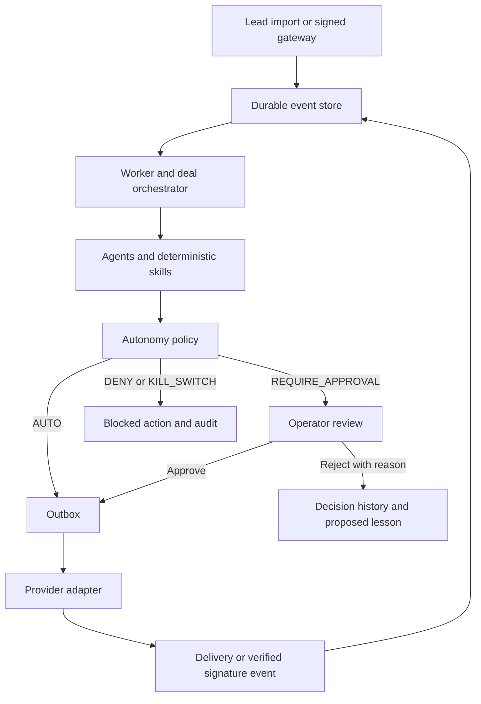

# Agentic Revenue System: executive and technical overview

## Executive summary

The system assists revenue teams from lead intake through qualification, outreach, commercial proposals, approval, delivery, and signature handling. Agents interpret language and return typed proposals. Application code calculates scores, controls state transitions, enforces approval rules, and records operational evidence.

The platform supports brand and publisher segments through configuration packs. The operational interface covers pipeline records, approvals, queued deliveries, lessons, audit history, and failed-work recovery.

## What is an agentic system?

An agent interprets context and proposes a useful response rather than following only a fixed text template. In this system, agents draft outreach, classify replies, extract qualification evidence from calls, and map commercial data into a structured document draft.

Authority is explicit. A model cannot approve an action, change deterministic scores, override consent, or deliver mail directly. Those responsibilities remain in ordinary application services with testable rules.

## Architecture

The application is a modular monolith with three operational entry points: the dashboard, signed event receiver, and durable worker. All use one operational database and the same domain rules.

### Reasoning engine

The runner boundary supports OpenRouter or the Claude Agent SDK. Live requests include the versioned prompt and structured context; Pydantic validates outputs. Outreach receives company/contact context, segment messaging, and reviewed lesson statements. Reply and transcript content is treated as untrusted data.

Research and pipeline-analysis tool scopes are declared, but full external company research and a model-backed pipeline analyst remain further integration work. Existing deterministic scoring and stall detection operate independently of those agents.

### Operational memory

SQLite stores deals, events, approvals, outbox items, lessons, audit records, flags, and timers. State survives process restarts. Database claims prevent two workers from processing the same active item, and expiring leases permit interrupted work to be recovered.

Lessons begin as proposed. Operators review and promote them before outreach can retrieve their statements. Rejections capture a reason and create a proposed lesson; they do not automatically modify policy rules.

### Tools and integrations

Adapters isolate mail, e-signature, CRM property updates, transcript retrieval, and persistence. Disabled integrations refuse execution explicitly. Native provider events require a verified gateway mapping into the signed internal webhook contract.

The current signature adapter references a configured document URL. Deployment must ensure that the exact approved document is the artifact presented to the signer.

### Guardrails and governance

Policy has four outcomes:

| Outcome | Behavior |
|---|---|
| `AUTO` | Permitted action enters the execution queue without human approval |
| `REQUIRE_APPROVAL` | Action waits for an operator to inspect and decide |
| `DENY` | Unsafe or unsubscribed-contact action is blocked |
| `KILL_SWITCH` | Global emergency control pauses routing and delivery |

Tier-A first-touch outreach, pricing changes, and contract sends require human approval. Unsubscribe state is checked both when proposing contact actions and when delivering previously queued work. Suspicious inbound instructions are flagged rather than executed.

## Operational workflow

1. A CRM gateway or JSON import supplies a stable lead ID, segment, company, contact, and supporting evidence. The system does not discover prospects independently.
2. Intake validates the record and stores an idempotent `lead.created` event.
3. The worker claims the event. The orchestrator creates the deal, calculates a deterministic score and tier from supplied features, and requests an outreach draft.
4. The policy evaluates the proposed action. High-impact sends become approval requests; permitted actions enter the outbox; denied actions create audit evidence.
5. An operator opens the full proposal, including recipient, subject, body or document, score, and policy reason. Approval queues the reviewed action; rejection records the reason and proposes a lesson.
6. The delivery service claims queued work, checks the kill switch and current consent state, then calls the configured provider. Success stores the provider reference and emits `action.delivered`.
7. A verified reply is classified. Engagement evidence can rescore the lead and advance it to engaged. An unsubscribe blocks future contact actions.
8. A verified transcript is digested into qualification fields and a proposed lesson. The orchestrator checks segment requirements before qualification. Explicit commercial terms permit document drafting, deterministic validation, and contract approval.
9. An approved signature request enters contracting after confirmed delivery. A verified completed-signature event closes the deal only when delivered-contract evidence matches the deal.
10. Durable stage timers flag stalled work; failed events and deliveries retain errors, attempts, and recovery controls.

## Scoring and segment packs

`skills/scoring.py` computes fit, intent, and engagement contributions using pack weights. Before engagement evidence exists, its weight is redistributed across available dimensions. Thresholds and a minimum fit gate determine the tier, and every score includes a human-readable reason.

A segment pack is a YAML configuration file plus templates. It supplies messaging, qualification fields, scoring weights and thresholds, document template references, and stage SLAs. Both included segments use the same orchestration code; automated end-to-end tests exercise their different contracts.

## Governance, risk, and compliance

The dashboard requires configured authentication in production and attributes operator decisions to that identity. HTTPS, deployment access controls, retention policies, backup/restore procedures, alerting, and credential rotation must be established for the operating environment.

Database transactions commit event business changes and acknowledgement together. Failed attempts roll back business writes and follow bounded exponential retry timing. Exhausted work becomes visible for explicit recovery.

External delivery is at least once. A provider can accept a request before local confirmation is recorded, so a stable idempotency key is retained and ambiguous outcomes require reconciliation. The application does not claim universal exactly-once delivery or legal compliance certification.

## Benefits

- Consistent qualification and explainable scores.
- Faster drafting, reply triage, and call summarization.
- Human review at high-impact execution boundaries.
- Segment variation through configuration rather than duplicated workflows.
- Persistent state, retry recovery, and visible operational evidence.
- A reviewed knowledge loop that informs later drafting.

## Deployment and next steps

Start with the [README](../README.md) for installation and operational commands. The [production runbook](production.md) specifies webhook contracts, authentication, retry behavior, and recovery. The [architecture](architecture.md) and [decision record](decisions.md) explain the component boundaries and trade-offs.

Before public or scaled deployment, verify native provider gateways, CRM synchronization, exact-document signature handling, HTTPS, supervision, monitoring, and restore procedures. Move from SQLite to an appropriate database/queue architecture when concurrency or multiple application hosts require it.
